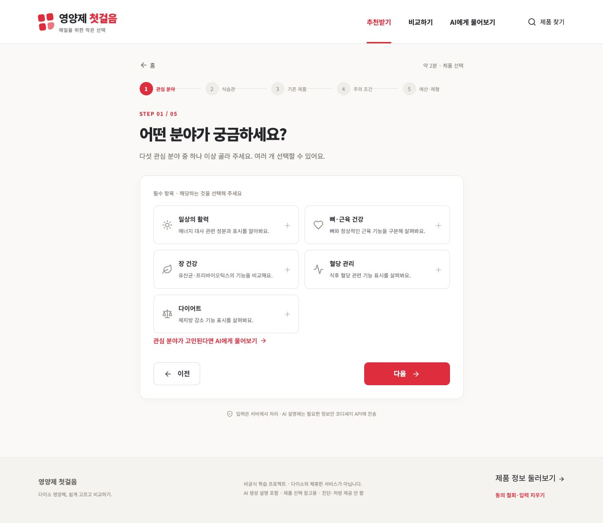
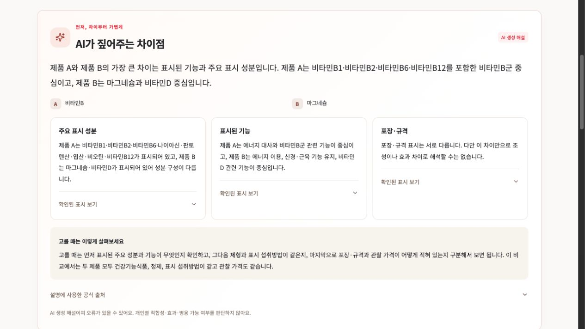

# 구현 검증 결과와 재현 방법

정리일: 2026-10-24 · 코드 `0bc17dc` · [제출 목차](README.md)

아래는 **개발자의 가상 입력·공개 제품을 사용한 기술 QA**다. 실제 사용자5명의 피드백이나 임상·독립 원문 검증이 아니다. 검사 범위를 구분하고 실패를 제외하지 않았다.

## 로컬 자동 검사

2026-10-24에 현재 작업 폴더에서 실행했다. 검증 당시 런타임 소스는 운영 기준과 같고 문서·제출 검사 도구만 추가 중이다.

| 검사 | 결과 | 검증 범위와 한계 |
|---|---|---|
| `.venv/bin/python -m pytest -q` | **159 passed**,9.05초 | 정책·수량·API·Agent·개인정보·비교 경계. 외부 모델을 대체하는 테스트 포함, 실제 GPT 성공 보장 아님 |
| `npm test` (frontend) | **15 passed** | 화면 연결 보조 로직·설문/비교 요청·서버 대기 등. 전체 브라우저 E2E가 아님 |
| `npm run build` | TypeScript/Vite 빌드 성공 | 배포 번들 생성. 모든 화면의 시각 품질 보장 아님 |
| `python3 scripts/validate_product_database.py` | **14,587 checks** 통과 | 저장된 원문/검수 결정·JSON/DB·수량·해시·외래키 일치. 독립 판독 검수 아님 |
| `python3 scripts/validate_product_thumbnails.py` | **88 available /87 public /88 unique** | 썸네일 파일·참조·공개 제품 연결 |

백엔드 검사에는 Starlette TestClient의 httpx 사용 방식에 대한 폐기 예정 경고1개가 있었다. 실패는 아니며 의존성 갱신 시 확인할 항목이다. 이 숫자를 실제 사용자의 성공률로 표현하지 않는다.

## 운영 API: Must 3회 반복

[원본 결과](evidence/acceptance-api.json)·[검사 도구](../../scripts/check_submission.py). 2026-10-24 실행. 매회 새 동의 연결을 만들고 종료 후 폐기했다. 실제 COPA GPT를 호출했다.

| ID | 1회 | 2회 | 3회 | 기대 결과 성공 | 확인 범위 |
|---|---|---|---|---|---|
| M01 | 성공 | 성공 | 성공 |3/3| 동의 전401·누락400·철회 후401·공개 비교200 |
| M02 | 성공 | 성공 | 성공 |3/3| 필수 관심 누락·제외 관심 값422 |
| M03 | 성공 | 성공 | 성공 |3/3| 표시 읽기 시작 질문·실제 도구·인용·제품 미선택 |
| M04 | **검증 실패** | 성공 | 성공 |**2/3**| 활력 가상 조건·예상3개 후보·실제 AI 해설·후보 출처·도구 |
| M05 | 성공 | 성공 | 성공 |3/3| 상세 필수 표시·원문 URL·확인일·보류404 |
| M06 | 성공 | 성공 | 성공 |3/3| 등록 두 제품 마그네슘 하루 표시 합계630mg |
| M07 | 성공 | 성공 | 성공 |3/3| 두 제품 표시표·칼슘 섭취 기준·중복 선택422 |
| M09 | 성공 | 성공 | 성공 |3/3| 임신/수유 제한·기존 미확인/특화 미확인 부족·AI 미요청 |
| S01 | 성공 | 성공 | 성공 |3/3| 첫 비교 해설 실제 생성1회, 이후 공용 캐시2회·양쪽 출처 |

M04 첫 시도는 `AssertionError`로 기록되었다. 검사 당시 응답의 세부 실패 필드를 보존하지 않아 **후보 불일치인지 AI 해설 검증 실패인지 이 로그만으로 원인을 확정할 수 없다.** 이후 두 번은 예상 후보600000129·601678603·613602132와 AI/출처 검증에 성공했다. 과제의 ‘3회 중2회’ 기준에는 도달했지만 모든 호출이 안정적으로 성공했다고 주장하지 않는다. 다음 유지보수 때 개인정보 없는 실패 진단 항목을 더 기록할 필요가 있다.

이 API 검사는 대표 사례이며 모든 화면 조작·모든 관심 조합을3회씩 검증한 것은 아니다. 다른 관심·포장 중복·특화 제한 등의 분류 회귀는 로컬 테스트와 [추천 연결 기록](../recommendation-v2-live-check.json)을 함께 본다. 명세의 화면별 재현 방법은 평가자가 직접 확인할 수 있게 기재했다.

이번 성공 사례의 소요 시간은 시작 질문7.19~11.32초, 추천12.78~15.65초였다. 단일 직렬 실행의 표본이며 부하 성능·SLA·최초 기동 시간 측정이 아니다. 캐시를 새 AI 생성으로 세지 않았다.

## 운영 브라우저: M01·M02

[브라우저 기록](evidence/acceptance-browser.json). 3회 모두 동의 누락 차단 → 3개 안내 동의 → 관심 누락 차단 → 선택 후 이전/다음 값 유지 → 설문5단계 진입 → 철회/초기화를 확인했다. **마지막 설문 제출·추천 화면 전체를 이3회 검사에 포함하지 않았다.** 추천·대화·비교는 별도 API 검사와 아래 릴리스 자료로 확인했다.



## 운영 릴리스 근거

2026-10-23 자료를 작성 당시 그대로 보존했다.

- [릴리스 확인](evidence/production-release-2026-10-23.json): 코드SHA·Render 서비스/배포ID·live·AI설정·CI결과.
- [운영 API](evidence/production-api-2026-10-23.json): 상품87개·동의·실제 장 추천/대화·표시 비교·중복·제한·철회.
- [추가 검사](evidence/production-extra-2026-10-23.json): 활력·제외 관심·범위 확인·AI 비교·캐시.
- [production CI](https://github.com/sayknow/M2-1/actions/runs/39926789312): Promotion policy /Backend checks /Frontend checks /Product data checks 성공.



## 재현

```sh
# 키 없이 실행하는 로컬 검사 (루트)
.venv/bin/python -m pytest -q
python3 scripts/validate_product_database.py
python3 scripts/validate_product_thumbnails.py
python3 scripts/validate_final_docs.py
# frontend 폴더에서
npm test
npm run build
```

실제 호출은 사용량을 소비한다. 아래는 새 보고서 경로를 지정해 기존 증빙을 덮어쓰지 않는 예다.

```sh
.venv/bin/python scripts/check_submission.py --run-live \
  --base-url https://m2-1-api.onrender.com \
  --report /tmp/m2-1-acceptance-new.json
```

모바일 실기기 전체 검증·다수 사용자 부하·현재 무료 한도 소진 시험·장시간 유휴 후 정확한 기동 시간·독립 임상 검증은 수행한 것으로 기록하지 않는다. 실사용자 원본·개인 기여 확인은 [제출 체크](README.md)에서 별도로 관리한다.
